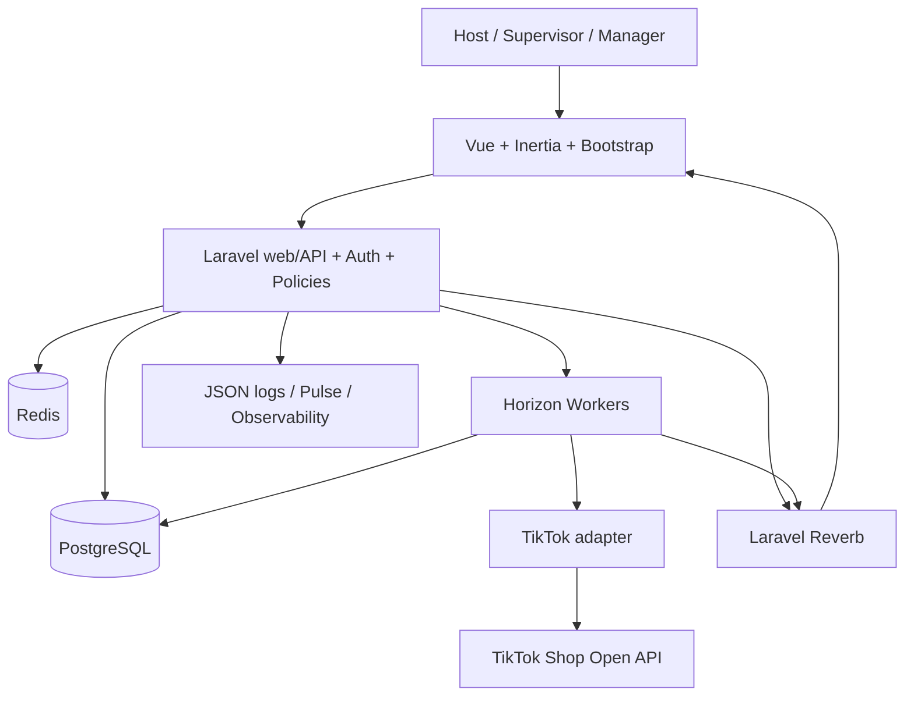

# Architecture and technology stack

## Runtime selection (baseline)
- Laravel 13 + PHP 8.4+; validate exact release and dependency constraints at project bootstrap.
- Vue 3 + TypeScript + Inertia (server-driven route/controllers; no duplicate REST API for every internal screen).
- Bootstrap 5.3 and a small tokenized UI component library; Vite.
- Laravel Reverb + Echo for application events.
- PostgreSQL 17+, Redis for cache/queue/realtime scaling, Horizon for queue inspection, Laravel Scheduler.
- Object storage compatible with S3 (optional MVP for attachments), Mail transport, JSON logging, local Telescope (never exposed publicly).

Prefer **modular monolith** to microservices: a single application repository and deployment, layered by domain, with explicit provider boundaries.

## Logical diagram



## Bounded domains
```
app/
  Domain/
    Identity/           # organizations, memberships, roles, policies
    Workforce/          # host, schedules, shift lifecycle, attendance
    Live/               # sessions, match, per-minute metrics
    Commerce/           # order item, SKU mapping, reporting units
    Performance/        # attribution, reconciliation, KPI, fee rules
    Operations/         # SOP, checklists, feedback, reviews
    Integrations/       # providers, tokens, sync states
  Integrations/
    Contracts/          # LiveAnalyticsProvider, ShopAuthorizationProvider
    TikTok/             # OAuth, signer, HTTP client, normalized DTO, jobs
  Http/
    Controllers/
    Requests/
  Events/
  Jobs/
resources/js/
  Pages/                # Inertia routes grouped by domain
  Components/
  Composables/
  Types/
tests/
  Feature/
  Unit/
```

Use contracts and DTOs to prevent provider response fields leaking into general application models. Persist raw response *selectively*, encrypted where necessary, with retention policy and versioned provider schema for troubleshooting.

## Typical write/read lifecycle
1. Host uses authenticated check-in. Laravel transaction validates tenant and active shift uniqueness, inserts authoritative timestamp, records audit event.
2. After commit, dispatch domain event and broadcast via Reverb to authorized tenant channel.
3. Scheduler/worker syncs finished live sessions and minute metrics through adapter, paginating and respecting rate limits.
4. Normalize and upsert source metrics by provider, store, session and minute; jobs have idempotency keys and retries with exponential backoff.
5. Recompute versioned attribution transactionally; mark exceptions for supervisor.
6. Derived dashboard uses indexed queries/materialized aggregates; broadcasting sends `sync.completed` only when database commit finishes.

## Reverb boundaries
- Reverb is **not** an external platform event feed. It reflects LCM's own writes and sync results.
- Use private channels `organization.{organizationId}.operations`, `organization.{organizationId}.live.{sessionId}`, `organization.{organizationId}.host.{hostId}` with explicit tenant membership authorization.
- Avoid broadcasting access tokens, order PII, full webhook payloads or unapproved financial data.
- Broadcast after commit; send lightweight IDs and change statuses, reload authorized detail via HTTP.
- Multi-instance Reverb needs a shared Redis scaling strategy, TLS/reverse proxy and isolated workers.

## Architecture decisions
- Inertia removes unnecessary internal API duplication while still allowing versioned REST APIs for mobile/integrations.
- PostgreSQL is chosen for constraints, transactional integrity, JSONB diagnostics, indexes and analytics; no separate warehouse at MVP scale.
- Redis/Horizon makes delayed polling, rate-limit backoff and sync observability straightforward.
- TypeScript types should derive from explicit page DTOs/schemas, not from ad-hoc Eloquent serialization.
- Enforce boundaries in authorization and DB queries, not by merely hiding UI navigation.
